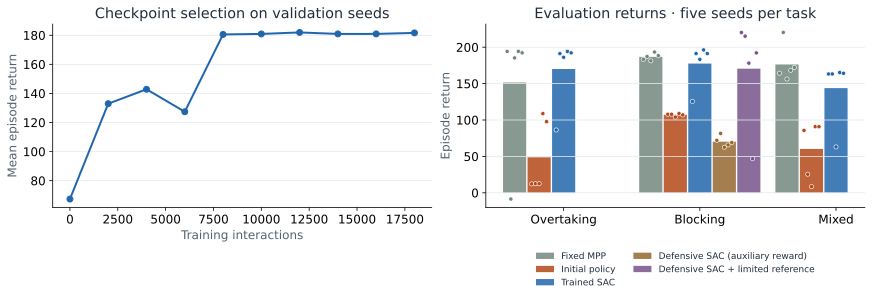

# HILEPP · recreated hierarchical racing policy

**A learned race strategy wrapped around vehicle_gym’s nonlinear motion planner.**

[Interactive research page](https://rudolfreiter.github.io/hilepp/) · [ECC 2023 paper](https://ieeexplore.ieee.org/document/10178143) · [Author manuscript](https://publications.syscop.de/Reiter2023.pdf) · [vehicle_gym](https://github.com/RudolfReiter/vehicle_gym)


> **This is a recreated implementation, not the original HILEPP training repository.** The included checkpoint was trained afresh. It is not an original paper checkpoint, and these results do not reproduce the paper’s full benchmark.

## Research

**A Hierarchical Approach for Strategic Motion Planning in Autonomous Racing**<br>
Rudolf Reiter, Jasper Hoffmann, Joschka Boedecker, Moritz Diehl.<br>
**European Control Conference (ECC 2023)**, Bucharest, pp. 1–8.<br>
DOI: [10.23919/ECC57647.2023.10178143](https://doi.org/10.23919/ECC57647.2023.10178143).

The policy chooses speed and lateral references. A reference generator expands them into a trajectory/cost specification, and nonlinear model predictive control computes the force and steering-rate commands. The policy does not directly output throttle or steering. Both the policy and MPC run every 0.25 s. Only the first MPC control is applied before measuring the new state and replanning. See [control and prediction semantics](docs/CONTROL_AND_PREDICTION.md) for the exact opponent assumptions and event definitions.

```text
Curvature + ego state + opponents
                  │ 22 observations
                  ▼
           SAC neural policy
                  │ HILEPP-I: v_ref, n_ref
                  │ HILEPP-II: also w_v, w_n
                  ▼
          Reference expansion
                  ▼
    vehicle_gym nonlinear motion planner
                  │ force, steering rate
                  ▼
          Original vehicle dynamics
```

## Install and replay

Use the **improved vehicle_gym 1.2** checkout beside this repository. The pinned foundation commit is recorded in `PROVENANCE.json`; `requirements-foundation.txt` provides a Git installation once that commit is pushed.

```bash
# Expected siblings: vehicle_gym/ and hilepp/
cd hilepp
python3 -m venv .venv
source .venv/bin/activate
pip install -e ../vehicle_gym -e '.[train,dev]'
OPENBLAS_NUM_THREADS=1 OMP_NUM_THREADS=1 python -m hilepp.evaluate --defense-dir checkpoints/defense --defense-reference-limit 1.0
python -m pytest
python -m http.server 8000 --directory docs
```

Open <http://localhost:8000>. The committed page already includes replay data; Python is only needed to regenerate it. GitHub Pages must be enabled before the public page link becomes live.

For inference without PyTorch, install `pip install -e ../vehicle_gym -e .` and use the NumPy checkpoint:

```python
from hilepp.interface import HileppEnv
from hilepp.policy import NumpyPolicy, HierarchicalPolicy

env = HileppEnv("I", max_steps=96)
obs, _ = env.reset(seed=10000, options={"scenario": "overtaking"})
policy = NumpyPolicy("checkpoints/best.npz")
while not env.world.finished:
    obs, reward, terminated, truncated, info = env.step(policy(obs))

# Alternatively, request a plan without advancing the simulation:
env.reset(seed=10000)
plan = HierarchicalPolicy(policy, env).plan()
```

Any callable returning normalized actions can be supplied to `HierarchicalPolicy`. An optional `gymnasium_env()` adapter is available with `pip install -e '.[gym]'`; the framework-independent API is used in the included training and evaluation. The optional Gymnasium adapter has not been exercised locally.

## Train and evaluate

```bash
# Preserve the included checkpoint; train into a separate directory.
OPENBLAS_NUM_THREADS=1 OMP_NUM_THREADS=1 python -m hilepp.train \
  --steps 18000 --seed 7 --variant I --output checkpoints/new-run
python -m hilepp.evaluate --checkpoint-dir checkpoints/new-run --output artifacts/new-run

# HILEPP-II interface is implemented, but no trained II checkpoint is included.
python -m hilepp.train --variant II --steps 18000 --output checkpoints/variant-ii
```

SAC uses a squashed Gaussian actor, twin Q networks, target critics, fixed entropy coefficient 0.1, learning rate 3e-4, discount 0.99, Polyak coefficient 0.005, two hidden layers of width 64, batch size 128, and 256 random warmup steps. No differentiation through the planner is used. Time limits bootstrap; terminal failures do not. Checkpoints contain only the deterministic actor’s mean parameters, not optimizer/replay state; they are inference exports, not resumable training snapshots.

Training samples episode seeds 0–6999. Validation seeds 8000–8002 select checkpoints every 2000 interactions. Held-out seeds 10000–10004 are evaluated only after selection, on each of three tasks. The page always shows test seed 10000 for each method, not a handpicked successful run.

## Defensive training extension

The blocking page also offers a **separate defensive SAC specialist**. It starts from the included general-policy actor snapshot and uses an auxiliary reward for covering a challenger’s line and actually slowing challengers. Its action at runtime is entirely the learned neural policy. This is an explicit extension to the paper’s training recipe. The standard SAC result remains separately visible.

```bash
python -m hilepp.train_defense \
  --warm-start checkpoints/defense/warm-start.npz \
  --steps 6000 --seed 17 --output checkpoints/new-defense
python -m hilepp.evaluate --defense-dir checkpoints/new-defense
```

Selection and evaluation use the **unmodified progress/rank reward**. The specialist is evaluated on five blocking seeds and is not pooled into the general-policy score. Its extra training reward and event definitions are documented in [METHOD.md](docs/METHOD.md). Omitting `--defense-dir` evaluates only the three general comparison methods.

The default blocking scene shows a further **limited-reference diagnostic**. Before each solve, `limit_lateral_reference` clips the neural policy’s requested lateral position to within 1 m of the measured ego position. Speed, costs, obstacle constraints, and collision checks remain the same. The original request and applied reference are both plotted. This limit was introduced after inspecting failed runs, so these five repeated scenarios are diagnostic evidence, not untouched held-out tests. The unrestricted defensive actor remains selectable, including all of its failures.

## Recorded results

<!-- RESULTS_START -->
18,000 general SAC interactions, training seed 7, 24-second episodes. Validation selected step 12,000. The fixed planner requests 32 m/s, equal to the learned policy’s speed limit.

| Method | Mean return, 15 test episodes | Mean final rank | Completed | Solver failures | Collisions |
|---|---:|---:|---:|---:|---:|
| Fixed MPP | 171.52 | 2.20 | 14/15 | 1 | 0 |
| Initial neural policy | 72.04 | 3.53 | 14/15 | 1 | 0 |
| General SAC | 163.80 | 2.00 | 12/15 | 3 | 0 |

The defensive specialist has 6,000 additional interactions (seed 17); validation selected step 5,000. Its five blocking tests are separate from the general comparison. All evaluation returns exclude the auxiliary training reward.

| Blocking method | Mean return | Defensive moves | Held-up vehicle-seconds | Opponent passes | Completed |
|---|---:|---:|---:|---:|---:|
| Fixed MPP | 186.74 | 0.00 | 0.10 | 2.00 | 5/5 |
| General SAC | 177.55 | 0.00 | 0.80 | 1.80 | 4/5 |
| Defensive SAC · auxiliary reward | 70.21 | 0.80 | 1.85 | 0.00 | 0/5 |
| Defensive SAC + 1 m reference limit | 170.54 | 2.00 | 3.00 | 1.40 | 3/5 |

The limited-reference variant uses the same defensive actor with its requested lateral position clipped to within 1 m of the current position. This limit was chosen after inspecting failed evaluations; its five repeats are diagnostics, not untouched held-out tests. All 55 episodes remain in the data. These are small-scale recreation results, not recovered paper benchmarks. Early failures remain in the averages and data. The replay shows the first test seed, 10000, for every method.
<!-- RESULTS_END -->



Raw [training log](checkpoints/training.json), [all test records](docs/data/evaluation.json), and [recorded trajectories/plans](docs/data/experiment.json) are committed. Every scene, trace, and table derives from those files. Figure regeneration: `python scripts/build_report.py`.

## Fidelity and limitations

See [paper-to-code mapping](docs/METHOD.md) for equations and implementation details.

- Uses the original vehicle_gym five-state Frenet model and the paper’s separation between RL and motion planning.
- Implements both HILEPP-I and II action interfaces; only I is trained here.
- Recreates observation structure and progress/rank reward. A −10 termination penalty is added for solver failure, collision, or leaving the track.
- Replaces acados/HPIPM with CasADi/IPOPT, uses a three-second horizon, and omits the recursive-feasibility terminal set.
- Uses the paper’s leader/follower role distinction for obstacle assumptions, with a simplified position integrator. Actual opponents use a gap-seeking passing controller with car following, rather than MPC. Faster blocking challengers cannot be outrun by the ego.
- Uses Frenet obstacle ellipses with bounded slack and oriented Cartesian body collision checks every 0.05 s; it does not establish continuous Cartesian collision freedom.
- Uses synthetic circuit sections, one training seed, 18,000 interactions, and 24-second episodes. The paper used a substantially larger training/evaluation protocol.
- The failed-plan rule stops before executing the rejected control; it is not a fallback vehicle controller.

## Layout and validation

`src/hilepp/`: action interface, policy wrapper, NumPy inference, SAC, training, evaluation.<br>
`checkpoints/`: new initial, selected, and final policies plus training log.<br>
`tests/`: interface, numerical update, checkpoint parity, and wrapper contract tests.<br>
`docs/`: static research page, plots, and replay data.<br>
`scripts/`: data checks, interaction checks, actual-renderer export, and source archive build.

```bash
python -m pytest
python scripts/check_data.py
node scripts/check_interactions.mjs
node scripts/render_scene.mjs
# Optional PNG export requires system GI / Rsvg / Cairo / Pillow:
/usr/bin/python3 scripts/rasterize_scenes.py
python scripts/build_site.py
```

The visualization starts paused and interpolates recorded physical states. The current ego plan and opponent obstacle assumptions refresh every 0.25 s. An optional held-opponent comparison shows the assumed and actual position at the same timestamp. Follower braking is a yielding feasibility assumption, not a prediction of intent. Event markers and relative-distance/speed plots expose actual passing and defensive interactions. The export renders the page’s Canvas commands into SVG; it is not a browser layout test.

MIT license. Citation metadata in [CITATION.cff](CITATION.cff). Dependency/source hashes and environment versions in [PROVENANCE.json](PROVENANCE.json).
