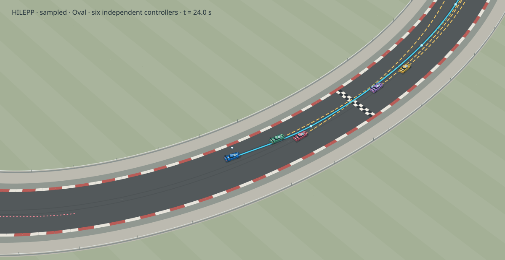

# HILEPP — hierarchical predictive racing with Deep Sets

Recreated implementation of **A Hierarchical Approach for Strategic Motion Planning in Autonomous Racing**, Rudolf Reiter, Jasper Hoffmann, Joschka Boedecker and Moritz Diehl, **ECC 2023**.

**This is not the original HILEPP repository.** This recreation uses permutation-invariant observations and periodic circuit races, with a smaller training budget and documented numerical differences.

[Interactive experiment](https://rudolfreiter.github.io/hilepp/) · [Paper](https://publications.syscop.de/Reiter2023.pdf) · [vehicle_gym](https://github.com/RudolfReiter/vehicle_gym)



## Controllers

| Policy | Ego controller | Five opponents |
|---|---|---|
| **HILEPP** | SAC sets speed/lateral references and their weights; nonlinear MPC computes commands | Independent racing MPCs |
| **SAC** | SAC directly commands force and steering rate; no ego MPC | Independent racing MPCs |
| **MPC** | Nonlinear MPC with fixed references and weights; no RL | Independent racing MPCs |

Every MPC solves from the same measured-state snapshot at every 0.2 s step. Only its first control is applied, and all vehicles advance simultaneously. The five opponents have different speed, longitudinal acceleration and cornering limits. A follower’s assumed braking trajectory uses its own maximum deceleration. The viewer shows current ego and obstacle horizons, with no frozen forecasts or ghost cars.

## Deep Sets observation encoder

The actor and both critics use independently learned [Deep Sets](https://arxiv.org/abs/1703.06114) encoders:

```text
opponent_i = [relative progress, lateral position, speed, heading error]
set         = rho(sum_i phi(opponent_i))
features    = concatenate(track curvature, ego state, set)
```

`phi` is a shared 4 → 64 → 32 ReLU network; `rho` is 32 → 32 → 32 with ReLU activations. Seven curvature samples and four ego features are concatenated with the 32-dimensional set embedding. The resulting 43 features enter the actor’s two 64-unit hidden layers. Each critic concatenates its own encoded observation with the action before its value network. Opponent IDs, order and positional encodings are absent.

The simulator’s 31-value buffer is only a transport format: the five opponent blocks are split before any learned layer. Permuting them leaves the policy and Q values unchanged, within floating-point tolerance. The encoder also handles an empty set or a different number of opponents, although the race protocol trains and evaluates six cars. NumPy exports contain the complete learned encoder, mean and, optionally, log standard deviation. Tests cover permutation invariance, encoder gradients and NumPy/PyTorch equivalence.

The recreated models combine Deep Sets with the paper’s state features and HILEPP interfaces. Their checkpoints are newly trained.

## Circuits and evaluation

The **Oval** is a synthetic ellipse with 125 m and 80 m semi-axes, approximately 650 m per lap. Races run for 240 s to create repeated encounters and lap traffic. **IMS** and **Sepang** use the same packaged geometry and renderer as vehicle_gym, with 180 s limits. HILEPP and MPC races have six independent MPC instances and warm starts; direct SAC races have five, for the opponents. No maneuver is scripted.

Both learned policies are trained from scratch for 12,000 interactions, alternating 90-second episodes between Oval and IMS with randomized starting locations. They use seed 52 and episode seeds beginning at 1000. Evaluation uses matched starts at seeds 30000–30002. The final checkpoints are evaluated as seeded Gaussian samples and as mean actions; both modes and every failed run remain available. The MPC recordings are shared between the two actor modes. Sepang is outside the training circuit set.

The published dataset contains 45 distinct races. All six HILEPP oval runs reach 240 s, covering 9.75–9.99 ego laps with 20–21 passes across the field. All three MPC oval runs also complete; direct SAC terminates early in all six oval runs. All methods reach the IMS time limit, while every Sepang run terminates early. The page reports speed and lateral-acceleration excess alongside duration and position: reaching the time limit does not establish constraint compliance.

This remains a diagnostic recreation. These runs do not establish superiority over MPC or recovery of the paper’s learned blocking strategy. Race duration and failure outcome must be considered alongside final position. Test seeds inspected during development are not an unseen benchmark.

## Install, train, evaluate

Use sibling `vehicle_gym` and `hilepp` checkouts. `requirements-foundation.txt` pins the exact foundation revision.

```bash
python -m venv .venv
source .venv/bin/activate
pip install -e ../vehicle_gym -e '.[train,dev]'
bash ../vehicle_gym/scripts/setup_acados.sh
# Export ACADOS_SOURCE_DIR and LD_LIBRARY_PATH as printed by that script.
export OPENBLAS_NUM_THREADS=1 OMP_NUM_THREADS=1

bash scripts/train_curriculum.sh
python -m hilepp.evaluate_circuit --tracks Oval IMS Sepang \
  --duration 180 --oval-duration 240 --seeds 30000 30001 30002 \
  --checkpoints checkpoints/deepsets --output docs/data
python scripts/check_data.py
python scripts/build_report.py
python -m http.server 8000 --directory docs
```

The default `hilepp-train` and `hilepp-evaluate` commands use the circuit experiment. Evaluation rejects flat-MLP checkpoints. The earlier flat-MLP actors in `checkpoints/circuit` and `checkpoints/pretraining` are retained only as historical artifacts and are not used by this page. NumPy inference needs no PyTorch or pickle; full optimizer checkpoints remain local and ignored by Git.

## HILEPP-II action interface

For normalized actions `a ∈ [−1, 1]⁴`:

```text
speed reference     = 24 + 4 a₀       m/s
lateral reference   = 3.5 a₁          m
speed cost weight   = 10^a₂
lateral cost weight = 2 × 10^a₃
```

Direct SAC uses `force = 10000 a₀ − 2000 N` and `steering rate = 0.3 a₁ rad/s`, subject to actuator saturation and the ego longitudinal envelope. It has no MPC state constraints or optimizer fallback. The pure-MPC ego targets 28 m/s and zero lateral offset, with weights 1 and 2. Reward is progress speed divided by 200 plus the number of opponents behind; physical termination adds −10.

See [method and deviations](docs/METHOD.md), [controller semantics](docs/CONTROL_AND_PREDICTION.md) and the replay manifest for all measured outcomes.

## Validation

```bash
python -m pytest
ruff check src tests scripts
python scripts/check_data.py
python scripts/check_dynamics.py
python scripts/check_policy.py
node scripts/check_interactions.mjs
python scripts/build_site.py
```

Committed replay checks need no acados installation. Regenerating races requires the compiled backend. DOM/Canvas interaction tests are not browser layout tests.

## Citation

Reiter, R., Hoffmann, J., Boedecker, J., and Diehl, M. **A Hierarchical Approach for Strategic Motion Planning in Autonomous Racing.** European Control Conference, 2023. [DOI: 10.23919/ECC57647.2023.10178143](https://doi.org/10.23919/ECC57647.2023.10178143).
